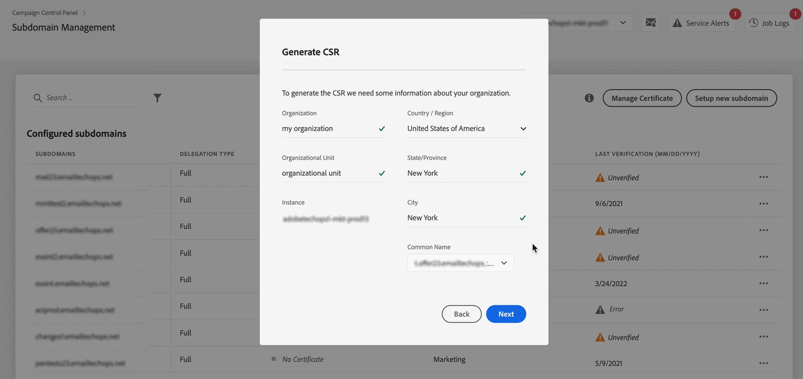

# Hinzufügen von SSL-Zertifikaten

Mit dem Adobe Campaign [!UICONTROL Control Panel] können Sie SSL-Zertifikate hinzufügen, um Ihre Subdomains zu schützen.

## Zugriff auf die Verwaltung von Subdomains im Control Panel

Um auf die Verwaltung von Subdomains im Control Panel zuzugreifen, navigieren Sie zu:

* [Experience Cloud Home](https://experience.adobe.com/#/home) > Lösungsauswahl: **[!DNL Campaign]** > **[!UICONTROL Control Panel]**-Karte > **[!UICONTROL Subdomains und Zertifikate]**-Karte

  oder
* Direkt über die URL: [https://experience.adobe.com/#/controlpanel/domain](https://experience.adobe.com/#/controlpanel/domain)

## Schritte zum Hinzufügen von SSL-Zertifikaten

Das Hinzufügen von SSL-Zertifikaten erfordert drei Schritte:

### &#x200B;1. Certificate Signing Requests generieren

Für den Kauf eines SSL-Zertifikats ist eine Certificate Signing Request (CSR) erforderlich. Sie muss für die Instanz und die Subdomains, die Sie schützen möchten, generiert werden.

Im folgenden Video erfahren Sie, wie Sie eine Certificate Signing Request im Control Panel generieren.

>[!VIDEO](https://video.tv.adobe.com/v/31317?learn=on){transcript=true}

*Certificate Signing Requests generieren (02:36 Min.)*

>[!NOTE]
>
>An der CSR-Generierung wurden verschiedene Verbesserungen vorgenommen:
>
>* Beim Generieren einer CSR können Sie jetzt eine der enthaltenen Subdomains als Gebrauchsnamen auswählen.
>* Sie können jetzt die CSR-Zusammenfassung kopieren, bevor Sie die CSR generieren.
>* Nachdem eine CSR generiert wurde, können Sie sie erneut aus den Auftragslogs herunterladen. Diese Funktion gilt nicht für Zertifikate, die vor dieser Version generiert wurden.
>
>
>
>Weitere Informationen erhalten Sie in der [Produktdokumentation](https://experienceleague.adobe.com/docs/control-panel/using/subdomains-and-certificates/renew-ssl/renewing-subdomain-certificate.html?lang=de).
>

### &#x200B;2. SSL-Zertifikat kaufen

Kaufen Sie nach dem Erhalt der CSR das SSL-Zertifikat von einer Zertifizierungsstelle, die von Ihrem Unternehmen validiert wurde.

### &#x200B;3. SSL-Zertifikate installieren

Nachdem Sie das SSL-Zertifikat erhalten haben, muss es für die Subdomains, die Sie schützen möchten, installiert werden.

Im folgenden Video erfahren Sie, wie SSL-Zertifikate im [!UICONTROL Control Panel]installiert werden.

>[!VIDEO](https://video.tv.adobe.com/v/31166?learn=on){transcript=true}

*SSL-Zertifikate installieren (01:25 Min.)*

